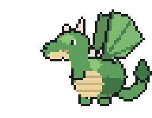
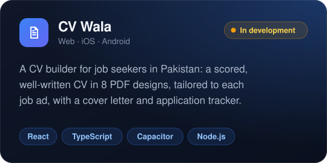
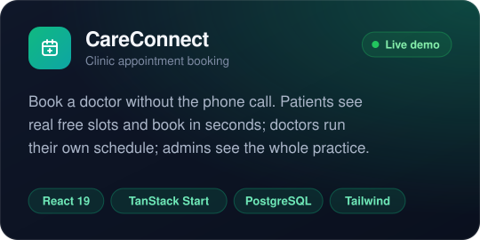
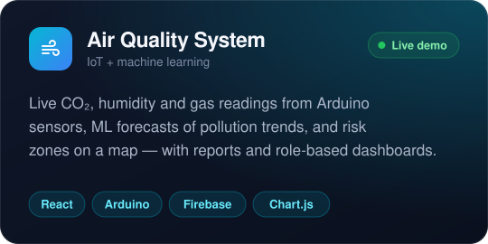
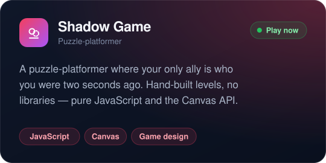
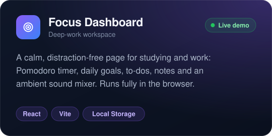
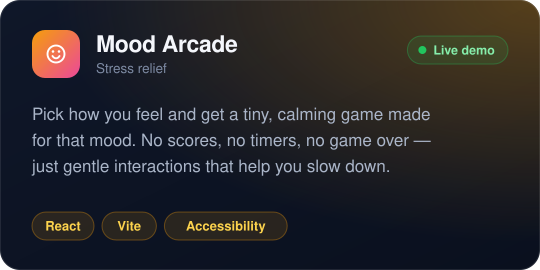

  

<picture>
  <source media="(prefers-color-scheme: dark)" srcset="assets/banner-dark.svg">
  
</picture>

  
  
  

## About me

I'm a full-stack and mobile developer. I take a product from the first sketch to something real people use, across the **web**, **Android** and **iOS**.

- **Web apps** with React and TypeScript, from booking systems to dashboards.
- **Mobile apps** in Java for Android, in Flutter, and as cross-platform apps with Capacitor.
- **Data and devices:** IoT sensors, machine-learning forecasts and real-time dashboards.

I care most about the person on the other side of the screen. The app should be clear and fast, and it should still work on a slow connection.

## Featured projects

<table>
  <tr>
    <td width="50%" valign="top">
      
      
Launching soon

    </td>
    <td width="50%" valign="top">
      
      
<a href="https://swift-appo-book.lovable.app">Live demo</a> · <a href="https://github.com/Haseeb35/swift-appo-book">Code</a>

    </td>
  </tr>
  <tr>
    <td width="50%" valign="top">
      
      
<a href="https://haseeb35.github.io/Air-Quality-Management-System-/">Live demo</a> · <a href="https://github.com/Haseeb35/Air-Quality-Management-System-">Code</a>

    </td>
    <td width="50%" valign="top">
      
      
<a href="https://haseeb35.github.io/Shadow-Game/">Play</a> · <a href="https://github.com/Haseeb35/Shadow-Game">Code</a>

    </td>
  </tr>
  <tr>
    <td width="50%" valign="top">
      
      
<a href="https://haseeb35.github.io/Focus-Dashboard/">Live demo</a> · <a href="https://github.com/Haseeb35/Focus-Dashboard">Code</a>

    </td>
    <td width="50%" valign="top">
      
      
<a href="https://haseeb35.github.io/Mood-Arcade-Stress-Relief-/">Live demo</a> · <a href="https://github.com/Haseeb35/Mood-Arcade-Stress-Relief-">Code</a>

    </td>
  </tr>
</table>

## Tech I work with

  
   
  

| Area | What I use |
|---|---|
| **Frontend** | React, TypeScript, TanStack, Tailwind CSS, Vite |
| **Backend and data** | Node.js, Express, PostgreSQL, Firebase |
| **Mobile** | Android (Java), Flutter (Dart), Capacitor for iOS and Android |
| **Also** | Python, Arduino and IoT sensors, machine learning for forecasting, Solidity |

## How I work

<table>
  <tr>
    <td width="25%" valign="top"><b>Design first</b> The small details are what make software feel good to use.</td>
    <td width="25%" valign="top"><b>Simple and reliable</b> Clear code that's easy to change beats clever code.</td>
    <td width="25%" valign="top"><b>Tested</b> The important rules have tests, so changes don't break them.</td>
    <td width="25%" valign="top"><b>Shipped</b> A finished project people can use beats a perfect one in a folder.</td>
  </tr>
</table>

## Let's connect

I'm open to freelance work and collaborations. The best way to reach me is **[LinkedIn](https://www.linkedin.com/in/haseeb-dar-64280b3ab/)**.

Islamabad, Pakistan · Building things people actually use.

