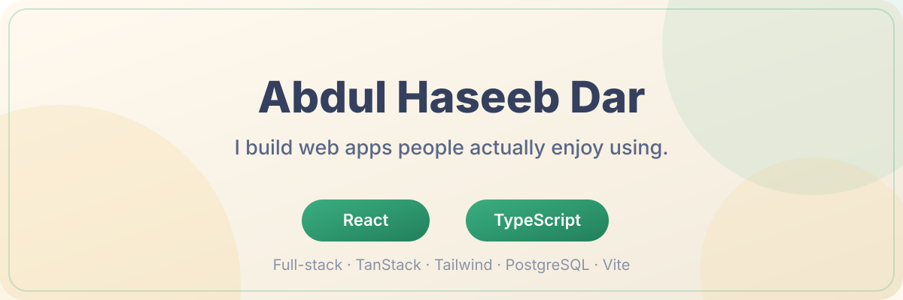

  

<h2 align="center">Hi, I'm Abdul Haseeb Dar 👋</h2>

  Full-stack web developer. I take an idea from a wireframe to a deployed product —
  and I have a healthy skepticism of phone trees and hold music.

---

### 🔭 What I'm working on

<table>
<tr>
<td width="60%">

<b>🩺 <a href="https://github.com/Haseeb35/swift-appo-book">CareConnect</a></b> —
Clinic appointment booking, minus the phone call. Real availability, doctor
self-service, role-based access. Patients book in seconds; nobody has to "check the
book and call you back."

</td>
<td width="40%">

<b>⚡ The motto</b> 
Build it simple. Ship it fast. 
Fix what's annoying. Repeat.

</td>
</tr>
</table>

### 🧰 The toolkit

  
  
  
  
  
  
  

### 😅 The truth about me

<table>
<tr>
<td>

<b>🎨</b> <b>Design-first</b> I care about the small UX details that make software feel good to use.

</td>
<td>

<b>🛠</b> <b>Boring on purpose</b> Reliable beats clever. Boring code is good code.

</td>
<td>

<b>🧪</b> <b>Tests win</b> If it compiles, it can still be wrong. That's what tests are for.

</td>
</tr>
<tr>
<td>

<b>😅</b> <b>Learning loudly</b> I once said "how hard can a booking system be?" It was, in fact, hard.

</td>
<td>

<b>☕</b> <b>Caffeine-loaded</b> Shipping relies on a healthy ratio of coffee to code.

</td>
<td>

<b>🚀</b> <b>Shipping things</b> A polished project in the wild beats a perfect one in a folder.

</td>
</tr>
</table>

### 📬 Find me

- GitHub — [github.com/Haseeb35](https://github.com/Haseeb35) (you're already here)
- LinkedIn — [linkedin.com/in/haseeb-dar](https://www.linkedin.com/in/haseeb-dar-64280b3ab/)
- Always open to interesting projects, collabs, and a good coffee conversation.

---

  <i>Built with ☕, React, and way too much curiosity about how things work.</i>

